```{r}
#| label: init
#| include: false

# libraries, the rules (R/eov_share.R) and the run flags ----
librarian::shelf(
  DBI, dplyr, duckdb, ggplot2, glue, jsonlite, knitr, readr, scales,
  stringr, terra, tibble, tidyr, tidyterra, quiet = T)
source("R/eov_share.R")

# flags (environment, all optional) ----
ver       <- "1.0.0"
test_n    <- as.integer(Sys.getenv("EOV_TEST_N", "0"))
is_test   <- !is.na(test_n) && test_n > 0
redo      <- Sys.getenv("EOV_REDO") == "1"
do_s3     <- Sys.getenv("EOV_S3") == "1" && !is_test   # a test run never uploads
scheme    <- Sys.getenv("EOV_WEIGHTS", "ohi")
q_score   <- as.numeric(Sys.getenv("EOV_Q", "0.99"))
verify_n  <- as.integer(Sys.getenv("EOV_VERIFY_N", "20"))
mem_gb    <- as.integer(Sys.getenv("BUILD_MEMORY_GB", "12"))
n_threads <- as.integer(Sys.getenv("BUILD_THREADS", "8"))
stopifnot(scheme %in% c("ohi", "mst_v1"), q_score > 0, q_score <= 1)

seeds     <- eov_seeds()
n_seed    <- nrow(seeds)
n_eov_all <- length(eov_keys())
url_pub   <- "https://s3.us-east-1.amazonaws.com/oceanmetrics.io-public"
url_prod  <- glue("{url_pub}/atlas/aquamaps_eov")
```

# Overview {#sec-overview}

Where on the ocean surface do the animals and plants that we monitor as **Essential Ocean Variables
(EOVs)** [@miloslavichEssentialOceanVariables2018] concentrate, and where do those concentrations
fall on species that are at risk of extinction? This notebook answers that with a gridded product,
`aquamaps_eov`, on the 0.05° global grid. It is both the pipeline that computes the product and the
documentation of how it is made, so the method and the data cannot drift apart (@fig-framework).

{#fig-framework .cc-diagram .nolightbox}

The framework in five moves:

1. **WoRMS AphiaID is the join key.** The EOVs are defined, exactly as in `obisindicators` and
   `obis-hex`, by `r n_seed` seed taxa of the IOOS Marine Life Data Network
   [@biddleMLDNEOVTaxonomy] that are expanded to all descendants in WoRMS
   [@wormsEditorialBoard2026]. Every taxon here carries the same AphiaID that the OBIS-based
   indicators use, so the two products are comparable taxon by taxon.
2. **AquaMaps suitability, not occurrences.** For each species the relative environmental
   suitability (1-100) of AquaMaps [@kaschnerAquaMapsPredictedRange2019;
   @readyPredictingDistributionsMarine2010], as delivered in MarineSensitivity release v9 on the
   0.05° grid, is **clipped to the IUCN range** of the species where one exists, so that suitable
   but unoccupied habitat does not count.
3. **Share, the MarineSensitivity v10 way.** A species' distribution is turned into a share: the
   fraction of its area-weighted habitat that falls in each cell [@marinesensitivity2026]. Every
   species weighs the same in an EOV, however wide its range.
4. **Extinction-risk weights.** Weighting each share by the equal-step IUCN Red List weights of
   Butchart et al. [-@butchartMeasuringGlobalTrends2004; -@butchartImprovementsRedList2007] and the
   Ocean Health Index [@halpernIndexAssessHealth2012] gives a `risk` metric beside the unweighted
   `share`.
5. **Petals and a composite.** Per cell and EOV the shares are summed, converted to a density and
   scored 0-100. The EOV scores are the petals of a flower plot and their mean is the composite
   `all`. The result is published as a STAC collection that the OceanMetrics atlas reads, and that
   anyone can read with `rstac`, `pystac` or DuckDB.

AquaMaps models neither birds nor seagrasses, so the **seabirds and seagrasses petals are absent
by construction**; the product has `r n_eov_all - length(eov_absent())` populated EOVs out of
`r n_eov_all`, and the composite averages only the petals that exist in a cell.

# Inputs and authority {#sec-inputs}

@tbl-inputs lists everything the product is built from. Nothing is downloaded by the notebook:
the MarineSensitivity files are the v9 release on this machine (`MSENS_DERIVED`), and the same
arrays that the published AquaMaps COGs were painted from.

```{r}
#| label: tbl-inputs
#| tbl-cap: "Inputs of the product: name, version or snapshot, STAC id or path, license and role."

inputs <- tribble(
  ~name,                          ~version,                  ~id_or_path,                                                       ~license,       ~role,
  "AquaMaps suitability",         "v10/2019 via MST v9",     "STAC msens-v9-am; dist/dataset=am/*.parquet",                    "CC BY-NC 3.0", "habitat suitability 1-100 per model and 0.05 degree cell",
  "IUCN range polygons (gridded)","MST v9",                  "STAC msens-v9-rng_iucn; dist/dataset=rng_iucn/*.parquet",         "IUCN terms",   "range footprint that clips the suitability",
  "Model to taxon registry",      "MST v9",                  "registry/taxon_model.parquet",                                    "CC BY 4.0",    "AquaMaps and range model to WoRMS AphiaID",
  "WoRMS",                        "download 2026-07-01",     "spp.duckdb table worms (STAC worms-2026-07-01)",                  "CC BY 4.0",    "taxonomy, EOV subtrees, accepted names",
  "IUCN Red List",                "2025 snapshot (2025-2)",  "spp.duckdb table iucn_redlist (STAC iucn-redlist-2025)",         "IUCN terms",   "category per species, weights",
  "MST taxon table (fallback)",   "MST v9",                  "v9/sdm.duckdb table taxon, column iucn_code",                     "CC BY 4.0",    "Red List category when the snapshot has none",
  "Grid cells and areas",         "MST v9",                  "v9/sdm.duckdb table cell (cell_id, lon, lat, area_km2)",          "CC BY 4.0",    "cell area A and centroids",
  "Grid template",                "global05",                "r_cellid_global.tif (pixel value = cell_id)",                     "CC BY 4.0",    "cell_id to raster pixel",
  "EOV seeds",                    "obisindicators 0.8.0",    "R/eov.R OBIS_EOV; IOOS MLDN eov_taxonomy/IdentifierList.csv (STAC ioos-mldn-eov-taxonomy)", "see source", "33 seed AphiaIDs of 7 EOVs")
kable(inputs, col.names = c("Input", "Version / snapshot", "STAC id or path", "License", "Role"))
```

**Authority and reuse.** The aim is that other projects can treat this product the way they treat
the places gazetteer (`oceanmetrics/places`): as a citable, versioned reference they read instead of
recompute. Four things make that possible. First, stable STAC ids and a semantic `version`, with the
upstream collections named in `sdm:derived_from`, so the lineage is machine-readable. Second,
`method.json` and `provenance.json` record every parameter, the weight table, the seeds and the
size and hash of every input. Third, every bulk file carries a `file:checksum` (multihash sha256)
and is read straight from the object store. Fourth, the collection's `describedby` link points at
this rendered notebook, so the human method and the data have one home. The AphiaID crosswalk
`eov_taxa.parquet` (AphiaID by EOV by Red List category by weight, WoRMS version pinned) is itself a
reusable asset: `obis-hex`, `obisindicators` and MarineSensitivity can join to it. The license is
inherited from AquaMaps (CC BY-NC 3.0, non-commercial) and is stated on the collection. @tbl-outputs
lists what is published.

```{r}
#| label: tbl-outputs
#| tbl-cap: "Files of the product, as staged and mirrored to s3://oceanmetrics.io-public/atlas/aquamaps_eov/."

bands_txt <- paste(seq_along(eov_bands()), eov_bands(), collapse = ", ")
outputs <- tribble(
  ~file,                              ~format,              ~description,
  "score_risk.tif, score_share.tif",  "COG Byte, nodata 255", glue("9 bands ({bands_txt}); scores 0-100, band 9 counts the reportable EOVs"),
  "density_risk.tif, density_share.tif", "COG Float32, nodata NaN", glue("{length(eov_levels())} bands (all and the EOVs); value per km2 before scoring"),
  "cells/eov=<g>/data.parquet",       "Parquet (zstd)",     "cell_id, share, risk, score_share, score_risk per cell, partitioned by EOV",
  "h3_r5.parquet",                    "Parquet (zstd)",     "area-weighted mean scores and densities per H3 cell, resolution 5",
  "eov_taxa.parquet",                 "Parquet (zstd)",     "crosswalk: AphiaID, EOV, models, range, Red List code and source, weight, cells, excluded",
  "eov_summary.csv",                  "CSV",                "per EOV and metric: n taxa, n with range, n weighted, q99",
  "method.json, provenance.json",     "JSON",               "every parameter, weights, seeds, input versions, hashes, software versions",
  "README.md, AGENTS.md",             "Markdown",           "human and agent guides, generated from the same R lists as this table",
  "thumbnail.png",                    "PNG",                "global map of the composite risk score",
  "collection.json, items/<eov>_<metric>.json", "STAC 1.1", "collection and 16 items (8 EOV values by 2 metrics)")
kable(outputs, col.names = c("File", "Format", "Description"))
```

# Method {#sec-method}

Notation: $s$ is a WoRMS species (AphiaID), $m$ an AquaMaps model of the species, $c$ a 0.05° cell
with area $A_c$ (km²), and $g$ an EOV.

**1. Suitability.** AquaMaps gives each model $m$ a relative environmental suitability
$v_{m,c}\in[1,100]$ [@kaschnerAquaMapsPredictedRange2019; @readyPredictingDistributionsMarine2010].
A species with several models takes the cell maximum, the MarineSensitivity rule:

$$
v_{s,c} = \max_{m \in M_s} v_{m,c}
$$ {#eq-suit}

**2. Range clip.** Let $R_s$ be the union of the cells of the IUCN range polygons of $s$
[@iucn2025]. When $R_s$ is not empty only suitable cells inside the range count; with no range the
full AquaMaps distribution is used. A species whose suitable cells never meet its range has no
habitat left and is excluded and counted.

$$
u_{s,c} =
\begin{cases}
v_{s,c}\,\mathbf{1}[c \in R_s] & R_s \neq \varnothing \\
v_{s,c} & R_s = \varnothing
\end{cases}
$$ {#eq-clip}

**3. Share.** The share is the cell's fraction of the species' area-weighted habitat over its whole
(global) distribution, so that $\sum_c \text{share}_{s,c}=1$ [@marinesensitivity2026]:

$$
\text{share}_{s,c} = \frac{u_{s,c}\,A_c}{\sum_{c'} u_{s,c'}\,A_{c'}}
$$ {#eq-share}

**4. Weight.** The Red List category of the species gives a weight $w_s$ (@tbl-weights): the
equal-step weights of Butchart et al. [-@butchartMeasuringGlobalTrends2004; -@butchartImprovementsRedList2007],
adopted by the Ocean Health Index [@halpernIndexAssessHealth2012]. Data Deficient (DD), Not
Evaluated and species without a category carry no weight and are left out of the weighted sum
(they still count in `share`). The category comes from the Red List snapshot by accepted scientific
name, and otherwise from the MST v9 taxon table.

$$
w_s = w(\text{category}_s),\qquad w_s \text{ undefined for DD, NE, none}
$$ {#eq-weight}

**5. Per EOV.** An EOV $g$ is the union of the WoRMS subtrees of its seeds (@tbl-seeds). Per cell
the two metrics are

$$
\text{share}_{c,g} = \sum_{s \in g} \text{share}_{s,c},
\qquad
\text{risk}_{c,g} = \sum_{s \in g} w_s\,\text{share}_{s,c}
$$ {#eq-eov}

**6. Score.** Values are densities $D = X / A_c$ (per km²), so that cell size does not drive the map.
The score caps at the $q$ quantile (default 0.99) of the densities over the cells where the EOV is
present:

$$
\text{score}_{c,g} = 100\,\min\!\left(1,\ \frac{D_{c,g}}{q_{0.99}(D_g)}\right)
$$ {#eq-score}

A cell is *reportable* for $g$ when any taxon of $g$ is present there; otherwise it is nodata. The
risk score can be 0 in a reportable cell (no weighted taxon).

**7. Composite.** The equal-weight mean of the reportable EOV scores, so that the mean of the
petals drawn in a flower plot equals the composite band:

$$
\text{score}_{c,\text{all}} = \frac{1}{|G_c|}\sum_{g \in G_c} \text{score}_{c,g},
\qquad G_c = \{g : \text{reportable}\}
$$ {#eq-composite}

The count $|G_c|$ is stored as `n_eov`. An H3 twin at resolution 5 averages scores and densities
with the cell area as weight. Two weighting schemes exist; `ohi` is the default and `mst_v1` is the
shifted variant of MarineSensitivity v1 (set with `EOV_WEIGHTS`).

```{r}
#| label: tbl-weights
#| tbl-cap: "Extinction-risk weights by IUCN Red List category, for both schemes (NA: no weight, excluded from risk). Legacy LR/lc maps to LC; LR/nt and LR/cd map to NT."

w_tbl <- eov_weights_table("ohi") |>
  rename(ohi = weight) |>
  left_join(rename(eov_weights_table("mst_v1"), mst_v1 = weight), by = "code")
kable(w_tbl, col.names = c("Category", "ohi (Butchart / OHI)", "mst_v1"), digits = 1)
```

```{r}
#| label: tbl-seeds
#| tbl-cap: "EOV seed taxa (WoRMS AphiaIDs) from the IOOS Marine Life Data Network eov_taxonomy, via obisindicators 0.8.0."

seeds |>
  group_by(eov, label) |>
  summarize(
    n_seeds = n(),
    seeds   = paste0(taxon, " (", aphiaid, ")", collapse = ", "),
    .groups = "drop") |>
  arrange(match(eov, eov_keys())) |>
  select(EOV = label, `n seeds` = n_seeds, `Seeds (AphiaID)` = seeds) |>
  kable()
```

# Pipeline {#sec-pipeline}

The chunks below read the inputs, run the rules of `R/eov_share.R` in DuckDB, write the product to
a staging directory and, only when asked, upload it (@fig-pipeline). The two long DuckDB passes
(species totals and the cell by EOV aggregation) are written as tables into a DuckDB file and
checkpointed, so a re-render reuses them unless `EOV_REDO=1`.

{#fig-pipeline .cc-diagram .nolightbox}

## Setup {#sec-setup}

```{r}
#| label: setup

# paths: inputs from the MarineSensitivity v9 release, outputs to a staging dir ----
dir_derived <- path.expand(Sys.getenv("MSENS_DERIVED", "~/_big/msens/derived"))
p <- list(
  taxon_model = file.path(dir_derived, "v9/marine-atlas/registry/taxon_model.parquet"),
  dist_am     = file.path(dir_derived, "v9/marine-atlas/dist/dataset=am"),
  dist_rng    = file.path(dir_derived, "v9/marine-atlas/dist/dataset=rng_iucn"),
  spp_db      = file.path(dir_derived, "spp.duckdb"),
  sdm_db      = file.path(dir_derived, "v9/sdm.duckdb"),
  cell_tif    = file.path(dir_derived, "r_cellid_global.tif"))
stopifnot(all(file.exists(unlist(p)) | dir.exists(unlist(p))))

dir_root <- path.expand("~/_big/oceanmetrics/aquamaps_eov")
dir_out  <- file.path(dir_root, if (is_test) "test" else ver)     # the staged product
dir_work <- file.path(dir_root, paste0("work_", basename(dir_out))) # DuckDB file, never published
for (d in c(dir_out, dir_work)) dir.create(d, showWarnings = F, recursive = T)

# DuckDB with a memory cap; inputs attached read-only ----
con <- dbConnect(duckdb(dbdir = file.path(dir_work, "eov.duckdb")))
run <- \(sql) invisible(dbExecute(con, sql))      # run a statement, print nothing
invisible(run(glue("SET memory_limit = '{mem_gb}GB'")))
invisible(run(glue("SET threads = {n_threads}")))
invisible(run(glue("SET temp_directory = '{file.path(dir_work, 'tmp')}'")))
invisible(run("SET preserve_insertion_order = false"))
invisible(run(glue("ATTACH '{p$spp_db}' AS spp (READ_ONLY)")))
invisible(run(glue("ATTACH '{p$sdm_db}' AS sdm (READ_ONLY)")))

tbl_exists <- \(t) t %in% dbListTables(con)
drop_all   <- \(prefix = "eov_") {
  for (v in grep(paste0("^", prefix, "(sp_cell|sp_clip|sp_share)$"), dbListTables(con), value = T))
    run(glue("DROP VIEW IF EXISTS {v}"))
  for (t in grep(paste0("^", prefix), dbListTables(con), value = T))
    run(glue("DROP TABLE IF EXISTS {t}"))
}

# checkpoint tables are valid only for the parameters that made them ----
prm <- toJSON(list(test_n = test_n, scheme = scheme, derived = dir_derived), auto_unbox = T) |> as.character()
old <- if (tbl_exists("eov_params")) dbGetQuery(con, "SELECT p FROM eov_params")$p else ""
if (redo || !identical(old, prm)) {
  drop_all()
  dbWriteTable(con, "eov_params", data.frame(p = prm), overwrite = T)
}

tibble(
  setting = c("version", "mode", "weights", "score quantile", "verify species", "upload",
              "memory", "threads", "staging dir", "inputs"),
  value   = c(ver, if (is_test) glue("test: first {test_n} species per EOV") else "full run",
              scheme, q_score, verify_n, if (do_s3) "EOV_S3=1" else "off",
              glue("{mem_gb} GB"), n_threads, dir_out, dir_derived)) |>
  kable()
```

## Taxa {#sec-taxa}

The EOV membership is the union of the WoRMS subtrees of the seeds (`eov_tree_sql()`), restricted to
species that have an AquaMaps model. The Red List category comes from the Red List snapshot by
accepted name, then from the MST v9 taxon table, and is turned into a weight.

```{r}
#| label: taxa

# EOV membership by WoRMS subtree ----
dbWriteTable(con, "eov_seed", seeds, overwrite = T)
run(glue("CREATE OR REPLACE TABLE eov_tree AS {eov_tree_sql('eov_seed', 'spp.worms')}"))

# AquaMaps models of WoRMS species ----
run(glue("
  CREATE OR REPLACE TABLE eov_am_map0 AS
  SELECT mdl_key, CAST(taxon_id AS BIGINT) AS aphia_id
  FROM read_parquet('{p$taxon_model}')
  WHERE ds_key = 'am' AND taxon_authority = 'worms'"))

# test mode keeps the first N species per EOV ----
rn_max <- if (is_test) test_n else .Machine$integer.max
run(glue("
  CREATE OR REPLACE TABLE eov_member AS
  SELECT eov, aphia_id FROM (
    SELECT eov, aphia_id, row_number() OVER (PARTITION BY eov ORDER BY aphia_id) AS rn
    FROM (SELECT DISTINCT t.eov, m.aphia_id
          FROM eov_tree t JOIN eov_am_map0 m ON m.aphia_id = t.taxonID))
  WHERE rn <= {rn_max}"))

# models with a partition file on disk ----
am_map <- dbGetQuery(con, "
  SELECT mdl_key, aphia_id FROM eov_am_map0
  WHERE aphia_id IN (SELECT aphia_id FROM eov_member)") |>
  mutate(file = file.path(p$dist_am, paste0(sub("^am\\|", "", mdl_key), ".parquet"))) |>
  filter(file.exists(file))
dbWriteTable(con, "eov_am_map", select(am_map, mdl_key, aphia_id), overwrite = T)

# IUCN range models of the same species ----
rng_map <- dbGetQuery(con, glue("
  SELECT mdl_key, CAST(taxon_id AS BIGINT) AS aphia_id
  FROM read_parquet('{p$taxon_model}')
  WHERE ds_key = 'rng_iucn' AND taxon_authority = 'worms'
    AND CAST(taxon_id AS BIGINT) IN (SELECT aphia_id FROM eov_member)")) |>
  mutate(file = file.path(p$dist_rng, paste0(sub("^rng_iucn\\|", "", mdl_key), ".parquet"))) |>
  filter(file.exists(file))
dbWriteTable(con, "eov_rng_map", select(rng_map, mdl_key, aphia_id), overwrite = T)

# range footprint (aphia_id, cell_id): read once, checkpointed ----
if (!tbl_exists("eov_rng")) {
  if (nrow(rng_map) > 0) {
    f_rng <- paste0("'", rng_map$file, "'", collapse = ", ")
    run(glue("
      CREATE TABLE eov_rng AS
      SELECT DISTINCT m.aphia_id, r.cell_id
      FROM read_parquet([{f_rng}], hive_partitioning = false) r
      JOIN eov_rng_map m ON m.mdl_key = r.mdl_key"))
  } else {
    run("CREATE TABLE eov_rng (aphia_id BIGINT, cell_id INTEGER)")
  }
  run("CHECKPOINT")
}

# Red List category: snapshot by accepted name, then MST v9 taxon table ----
run("
  CREATE OR REPLACE TABLE eov_redlist AS
  WITH sp AS (
    SELECT DISTINCT m.aphia_id, w.scientificName AS scientific_name
    FROM eov_member m LEFT JOIN spp.worms w ON w.taxonID = m.aphia_id),
  iu AS (
    SELECT lower(taxon_scientific_name) AS k,
           CAST(red_list_category_code AS VARCHAR) AS code
    FROM spp.iucn_redlist
    WHERE latest
    QUALIFY row_number() OVER (
      PARTITION BY lower(taxon_scientific_name) ORDER BY year_published DESC) = 1),
  fb AS (
    SELECT TRY_CAST(taxon_id AS BIGINT) AS aphia_id, any_value(iucn_code) AS iucn_code
    FROM sdm.taxon
    WHERE taxon_authority = 'worms' AND iucn_code IS NOT NULL
    GROUP BY 1)
  SELECT sp.aphia_id, sp.scientific_name,
         coalesce(iu.code, fb.iucn_code) AS redlist_code,
         CASE WHEN iu.code IS NOT NULL THEN 'iucn_redlist'
              WHEN fb.iucn_code IS NOT NULL THEN 'msens_v9_taxon' END AS redlist_source
  FROM sp
  LEFT JOIN iu ON iu.k = lower(sp.scientific_name)
  LEFT JOIN fb ON fb.aphia_id = sp.aphia_id")

# weights (NULL = no weight) ----
rl <- dbGetQuery(con, "SELECT * FROM eov_redlist")
rl$weight <- redlist_weight(rl$redlist_code, scheme)
dbWriteTable(con, "eov_weight", rl[c("aphia_id", "weight")], overwrite = T)

# cell areas and centroids ----
if (!tbl_exists("eov_cell")) {
  run("CREATE TABLE eov_cell AS SELECT cell_id, lon, lat, area_km2 FROM sdm.cell")
  run("CHECKPOINT")
}

n_member <- dbGetQuery(con, "SELECT eov, count(*) AS n FROM eov_member GROUP BY 1") |>
  arrange(match(eov, eov_keys()))
n_tree   <- dbGetQuery(con, "SELECT eov, count(DISTINCT taxonID) AS n FROM eov_tree GROUP BY 1")
n_cells_total <- dbGetQuery(con, "SELECT count(*) AS n FROM eov_cell")$n
n_worms  <- dbGetQuery(con, "SELECT count(*) AS n FROM spp.worms")$n
n_rl     <- dbGetQuery(con, "SELECT count(*) AS n FROM spp.iucn_redlist WHERE latest")$n
rl_year  <- dbGetQuery(con, "SELECT max(year_published) AS y FROM spp.iucn_redlist")$y
```

The WoRMS snapshot has `r format(n_worms, big.mark = ",")` taxa and the Red List snapshot
`r format(n_rl, big.mark = ",")` latest assessments (to `r rl_year`). Of the taxa under the seeds,
`r sum(n_member$n)` species (`r paste0(n_member$eov, " ", n_member$n, collapse = ", ")`) have an
AquaMaps model and enter this run; `r nrow(am_map)` models and `r nrow(rng_map)` IUCN range files
back them. The grid has `r format(n_cells_total, big.mark = ",")` ocean cells.

## Distributions {#sec-distributions}

`eov_share_sql()` writes the species-level statements: the species total
$\sum_c u_{s,c}A_c$ (a table, checkpointed) and the species share (a view, evaluated inside the
cell aggregation so that the billions of species by cell rows are never stored). Only the partition
files of the needed models are read.

```{r}
#| label: distributions

f_am   <- paste0("'", am_map$file, "'", collapse = ", ")
am_src <- glue("read_parquet([{f_am}], hive_partitioning = false)")
sql    <- eov_share_sql(
  am_tbl = am_src, map_tbl = "eov_am_map", rng_tbl = "eov_rng", area_tbl = "eov_cell",
  eov_tbl = "eov_member", weight_tbl = "eov_weight", out_prefix = "eov_")

# tables are checkpoints, views are always (re)defined ----
ckpt  <- c(sp_map = "eov_sp_map", sp_total = "eov_sp_total", cell_eov = "eov_cell_eov")
times <- list()
for (nm in names(sql)) {
  tb <- ckpt[nm]
  if (!is.na(tb) && tbl_exists(tb)) { times[[nm]] <- NA_real_; next }
  t0 <- Sys.time()
  run(sql[[nm]])
  if (!is.na(tb)) run("CHECKPOINT")
  times[[nm]] <- as.numeric(difftime(Sys.time(), t0, units = "secs"))
}
step_times <- tibble(step = names(times), seconds = unlist(times))
n_sp_total <- dbGetQuery(con, "SELECT count(*) AS n, sum(excluded::INT) AS n_excl FROM eov_sp_total")
kable(step_times, digits = 1, caption = "Seconds per statement (NA: reused checkpoint).")
```

The species table has `r n_sp_total$n` species, of which `r n_sp_total$n_excl` are excluded because
no suitable cell falls inside their IUCN range.

## Aggregate {#sec-aggregate}

```{r}
#| label: aggregate

# cells that have any value, with area ----
cells <- dbGetQuery(con, "
  SELECT cell_id, lon, lat, area_km2 FROM eov_cell
  WHERE cell_id IN (SELECT DISTINCT cell_id FROM eov_cell_eov)
  ORDER BY cell_id")
n_cell <- nrow(cells)
keys   <- eov_keys()
mk_mat <- \(x) matrix(x, n_cell, length(keys), dimnames = list(NULL, keys))

# densities per km2 (NA = EOV not reportable in the cell) ----
dens <- list(share = mk_mat(NA_real_), risk = mk_mat(NA_real_))
for (g in keys) {
  d <- dbGetQuery(con, glue("SELECT cell_id, share, risk FROM eov_cell_eov WHERE eov = '{g}'"))
  if (nrow(d) == 0) next
  i <- match(d$cell_id, cells$cell_id)
  dens$share[i, g] <- d$share / cells$area_km2[i]
  dens$risk[i, g]  <- d$risk  / cells$area_km2[i]
}
populated <- keys[colSums(!is.na(dens$share)) > 0]

# scores: q99 over the reportable cells of each EOV and metric ----
sc <- list(); q_rows <- list()
for (m in c("share", "risk")) {
  smat <- matrix(NA_integer_, n_cell, length(keys), dimnames = list(NULL, keys))
  for (g in populated) {
    present <- !is.na(dens$share[, g])
    s <- eov_score(dens[[m]][, g], q = q_score, ref = dens[[m]][present, g])
    smat[, g] <- s
    q_rows[[paste(g, m)]] <- tibble(eov = g, metric = m, q99 = attr(s, "q"))
  }
  sc[[m]] <- list(
    eov     = smat,
    all     = eov_composite(smat),
    n_eov   = eov_n(smat),
    dens_all = eov_density_all(dens[[m]]))
}
q_tab <- bind_rows(q_rows)

# band matrices in the published order ----
score_bands <- \(m) cbind(all = sc[[m]]$all, sc[[m]]$eov, n_eov = sc[[m]]$n_eov)
dens_bands  <- \(m) cbind(all = sc[[m]]$dens_all, dens[[m]])
stopifnot(identical(colnames(score_bands("risk")), eov_bands()),
          identical(colnames(dens_bands("risk")), eov_levels()))

n_report <- tibble(eov = populated,
                   n_cells = colSums(!is.na(dens$share[, populated, drop = F])))
```

`r n_cell` cells hold at least one EOV; the populated EOVs are `r paste(populated, collapse = ", ")`.

## Outputs {#sec-outputs}

```{r}
#| label: outputs

# COGs ----
cog_opts <- c("COMPRESS=DEFLATE", "BLOCKSIZE=512", "OVERVIEWS=AUTO", "RESAMPLING=AVERAGE")
for (m in c("risk", "share")) {
  r_s <- cells_to_raster(cells$cell_id, score_bands(m), p$cell_tif, nodata = 255)
  writeRaster(r_s, file.path(dir_out, glue("score_{m}.tif")), filetype = "COG",
              datatype = "INT1U", NAflag = 255, gdal = cog_opts, overwrite = T)
  r_d <- cells_to_raster(cells$cell_id, dens_bands(m), p$cell_tif, nodata = NaN)
  writeRaster(r_d, file.path(dir_out, glue("density_{m}.tif")), filetype = "COG",
              datatype = "FLT4S", NAflag = NaN, gdal = cog_opts, overwrite = T)
  rm(r_s, r_d); invisible(gc())
}

# cells/eov=<g>/data.parquet: share, risk and scores per cell ----
to_parquet <- function(df, path) {
  dir.create(dirname(path), showWarnings = F, recursive = T)
  duckdb_register(con, "tmp_df", df)
  run(glue("COPY (SELECT * FROM tmp_df) TO '{path}' (FORMAT parquet, COMPRESSION zstd)"))
  duckdb_unregister(con, "tmp_df")
  invisible(path)
}
unlink(file.path(dir_out, "cells"), recursive = T)
for (g in populated) {
  ok <- !is.na(dens$share[, g])
  to_parquet(tibble(
    cell_id     = cells$cell_id[ok],
    share       = dens$share[ok, g] * cells$area_km2[ok],
    risk        = dens$risk[ok, g]  * cells$area_km2[ok],
    score_share = sc$share$eov[ok, g],
    score_risk  = sc$risk$eov[ok, g]),
    file.path(dir_out, "cells", glue("eov={g}"), "data.parquet"))
}
# the composite: share and risk are the sums over EOVs, scores are the composite
ok <- sc$share$n_eov > 0
to_parquet(tibble(
  cell_id     = cells$cell_id[ok],
  share       = sc$share$dens_all[ok] * cells$area_km2[ok],
  risk        = sc$risk$dens_all[ok]  * cells$area_km2[ok],
  score_share = sc$share$all[ok],
  score_risk  = sc$risk$all[ok]),
  file.path(dir_out, "cells", "eov=all", "data.parquet"))

# h3 twin, resolution 5: area-weighted mean of scores and densities ----
invisible(run("INSTALL h3 FROM community"))
invisible(run("LOAD h3"))
h3_wide <- bind_cols(
  select(cells, cell_id, lon, lat, area_km2),
  as_tibble(score_bands("risk")[, c("all", populated, "n_eov")]) |> rename_with(\(x) paste0("score_risk_", x)),
  as_tibble(score_bands("share")[, c("all", populated)]) |> rename_with(\(x) paste0("score_share_", x)),
  as_tibble(dens_bands("risk")[, c("all", populated)]) |> rename_with(\(x) paste0("density_risk_", x)),
  as_tibble(dens_bands("share")[, c("all", populated)]) |> rename_with(\(x) paste0("density_share_", x)))
h3_cols <- setdiff(names(h3_wide), c("cell_id", "lon", "lat", "area_km2"))
duckdb_register(con, "h3_wide", h3_wide)
f_h3 <- file.path(dir_out, "h3_r5.parquet")
run(glue("COPY ({eov_h3_sql('h3_wide', h3_cols, 5)}) TO '{f_h3}' (FORMAT parquet, COMPRESSION zstd)"))
duckdb_unregister(con, "h3_wide"); rm(h3_wide); invisible(gc())
n_h3 <- dbGetQuery(con, glue("SELECT count(*) AS n FROM read_parquet('{f_h3}')"))$n

# eov_taxa.parquet: the AphiaID crosswalk ----
run("
  CREATE OR REPLACE TABLE eov_taxa AS
  SELECT m.aphia_id, rl.scientific_name, m.eov,
         (SELECT string_agg(replace(mm.mdl_key, 'am|', ''), ';' ORDER BY mm.mdl_key)
          FROM eov_sp_map mm WHERE mm.aphia_id = m.aphia_id) AS sp_keys,
         coalesce(t.n_models, 0)::INTEGER AS n_models,
         coalesce(t.has_range, false) AS has_range,
         (SELECT count(*) FROM eov_rng_map rm WHERE rm.aphia_id = m.aphia_id)::INTEGER AS n_range_ids,
         rl.redlist_code, rl.redlist_source, w.weight,
         coalesce(t.n_cells, 0) AS n_cells,
         coalesce(t.total_suit_area, 0.0) AS total_suit_area,
         coalesce(t.excluded, true) AS excluded
  FROM eov_member m
  LEFT JOIN eov_sp_total t ON t.aphia_id = m.aphia_id
  LEFT JOIN eov_redlist rl ON rl.aphia_id = m.aphia_id
  LEFT JOIN eov_weight w ON w.aphia_id = m.aphia_id
  ORDER BY m.eov, m.aphia_id")
f_taxa <- file.path(dir_out, "eov_taxa.parquet")
run(glue("COPY eov_taxa TO '{f_taxa}' (FORMAT parquet, COMPRESSION zstd)"))
taxa <- dbGetQuery(con, "SELECT * FROM eov_taxa")

# eov_summary.csv: per EOV and metric ----
tx_sum <- eov_summarize_taxa(taxa)
eov_summary <- tx_sum |>
  cross_join(tibble(metric = c("risk", "share"))) |>
  left_join(q_tab, by = c("eov", "metric")) |>
  bind_rows(
    tibble(eov = "all", n_taxa = n_distinct(taxa$aphia_id),
           n_with_range = n_distinct(taxa$aphia_id[taxa$has_range]),
           n_weighted   = n_distinct(taxa$aphia_id[!is.na(taxa$weight) & !taxa$excluded]),
           n_excluded   = n_distinct(taxa$aphia_id[taxa$excluded])) |>
      cross_join(tibble(metric = c("risk", "share")))) |>
  mutate(eov = factor(eov, eov_levels())) |>
  arrange(eov, metric) |>
  mutate(eov = as.character(eov))
write_csv(eov_summary, file.path(dir_out, "eov_summary.csv"))

# provenance: size, mtime and hash of every input ----
file_info <- function(path, hash_max = 2e8) {
  fi <- file.info(path)
  tibble(path = sub(paste0("^", dir_derived, "/"), "", path),
         size = fi$size, mtime = format(fi$mtime, "%Y-%m-%dT%H:%M:%SZ", tz = "UTC"),
         sha256 = if (fi$size <= hash_max) file_multihash(path) else NA_character_)
}
am_files_all <- list.files(p$dist_am, full.names = T)
manifest <- paste(basename(am_map$file), file.size(am_map$file), sep = ":") |> sort()
prov <- list(
  product = "aquamaps_eov", version = ver, test = is_test,
  generated = format(Sys.time(), "%Y-%m-%dT%H:%M:%SZ", tz = "UTC"),
  software = list(R = as.character(getRversion()), duckdb = as.character(packageVersion("duckdb")),
                  terra = as.character(packageVersion("terra")),
                  gdal = terra::gdal(), platform = R.version$platform),
  inputs = list(
    files = purrr::map(c(p$taxon_model, p$cell_tif, p$spp_db, p$sdm_db), file_info) |> bind_rows(),
    am_partitions = list(
      dir = "v9/marine-atlas/dist/dataset=am", n_files_dir = length(am_files_all),
      n_files_used = nrow(am_map), bytes_used = sum(file.size(am_map$file)),
      manifest_sha256 = digest::digest(paste(manifest, collapse = "\n"), algo = "sha256", serialize = F)),
    rng_partitions = list(
      dir = "v9/marine-atlas/dist/dataset=rng_iucn", n_files_used = nrow(rng_map),
      bytes_used = sum(file.size(rng_map$file))),
    worms = list(table = "spp.duckdb:worms", download = "2026-07-01", n_taxa = n_worms),
    iucn_redlist = list(table = "spp.duckdb:iucn_redlist", n_latest = n_rl, max_year = rl_year),
    seeds = "obisindicators 0.8.0 R/eov.R OBIS_EOV; IOOS MLDN eov_taxonomy/IdentifierList.csv"))
write_json(prov, file.path(dir_out, "provenance.json"), auto_unbox = T, pretty = T, digits = NA, null = "null")

# method.json: every parameter, weights, seeds, input versions ----
method <- list(
  product = "aquamaps_eov", version = ver,
  parameters = list(weights = scheme, score_quantile = q_score, test_n = test_n,
                    grid = "global05 0.05 degree, 7200 x 3600, cell_id row-major from top-left",
                    suitability = "AquaMaps 1-100, max over the models of a species",
                    clip = "IUCN range footprint when present, else full distribution",
                    share = "u * area_km2 / sum(u * area_km2) over the global distribution",
                    density = "value / area_km2", reportable = "any taxon of the EOV present in the cell",
                    composite = "equal-weight mean of the reportable EOV scores",
                    h3_resolution = 5L),
  method_detail = eov_method_detail(scheme, q_score),
  weights = list(ohi = eov_weights_table("ohi"), mst_v1 = eov_weights_table("mst_v1")),
  redlist_precedence = c("spp.duckdb:iucn_redlist (latest, by lower(accepted scientificName))",
                         "v9/sdm.duckdb:taxon.iucn_code", "none"),
  eov_bands = eov_bands(), eov_labels = as.list(eov_labels()), absent_eovs = eov_absent(),
  seeds = seeds, q99 = q_tab, summary = eov_summary,
  inputs = prov$inputs, software = prov$software)
write_json(method, file.path(dir_out, "method.json"), auto_unbox = T, pretty = T, digits = NA, null = "null", na = "null")
```

```{r}
#| label: docs

# README.md and AGENTS.md, from the same lists as the tables of this notebook ----
files_md <- paste0("| `", outputs$file, "` | ", outputs$format, " | ", outputs$description, " |", collapse = "\n")
w_md     <- paste0("| ", w_tbl$code, " | ", w_tbl$ohi, " | ", w_tbl$mst_v1, " |", collapse = "\n")
inp_md   <- paste0("- ", inputs$name, " (", inputs$version, "; ", inputs$id_or_path, "; ", inputs$license, ")", collapse = "\n")
readme <- glue("
# AquaMaps EOV share, version {ver}{if (is_test) ' (TEST RUN, subset)' else ''}

Extinction-risk weighted share of AquaMaps habitat by Essential Ocean Variable (EOV), on the 0.05
degree global grid of MarineSensitivity v9. Method and code: https://oceanmetrics.io/workflows/aquamaps_eov.html

{eov_method_detail(scheme, q_score)}

## Files

| file | format | description |
|---|---|---|
{files_md}

## Weights (scheme `{scheme}` is used here)

| category | ohi | mst_v1 |
|---|---|---|
{w_md}

## Inputs

{inp_md}

## License and citation

CC BY-NC 3.0 (non-commercial), inherited from AquaMaps. Cite OceanMetrics (2026) AquaMaps EOV share
v{ver}, and Kaschner et al. (2019) AquaMaps: Predicted range maps for aquatic species, www.aquamaps.org,
Version 10/2019. Seabirds and seagrasses are absent: AquaMaps models neither.
")
write_lines(readme, file.path(dir_out, "README.md"))

agents <- glue("
# AGENTS.md: using the aquamaps_eov collection

- STAC collection id `aquamaps_eov`, version `{ver}`: {url_prod}/collection.json
- 16 items `<eov>_<metric>`; eov in ({paste(eov_levels(), collapse = ', ')}); metric in (risk, share).
- The cell value of an item is in its `cog` asset (`../score_<metric>.tif`), band `atlas:bidx`
  (bands: {bands_txt}); value 0-100, nodata 255. Densities (per km2) are in the `density` asset.
- `atlas:flower` = dimension eov, composite all: petals are the sibling items across `eov` for one
  metric, the centre is `all`. Seabirds and seagrasses items are empty (`atlas:absent`).
- Cells: `cells/eov=<g>/data.parquet` (cell_id is the global05 row-major 1-based cell number).
  AphiaID crosswalk: `eov_taxa.parquet`. Parameters and hashes: `method.json`, `provenance.json`.
- Non-commercial use only (CC BY-NC 3.0); cite AquaMaps (Kaschner et al. 2019).
")
write_lines(agents, file.path(dir_out, "AGENTS.md"))

# thumbnail: global map of the composite risk score ----
r_thumb <- rast(file.path(dir_out, "score_risk.tif"), lyrs = 1) |>
  aggregate(fact = 10, fun = "mean", na.rm = T)
g_thumb <- ggplot() +
  geom_spatraster(data = r_thumb, na.rm = T) +
  scale_fill_viridis_c(na.value = "transparent", limits = c(0, 100), name = "score") +
  coord_sf(expand = F) + theme_void() + theme(legend.position = "none")
ggsave(file.path(dir_out, "thumbnail.png"), g_thumb, width = 6, height = 3, dpi = 100, bg = "white")
```

The product has `r n_h3` H3 cells at resolution 5 and `r nrow(taxa)` taxon by EOV rows in the
crosswalk.

## STAC {#sec-stac}

```{r}
#| label: stac

# assets with size and multihash checksum ----
f <- \(x) file.path(dir_out, x)
pq_type <- "application/vnd.apache.parquet"
cells_parts <- lapply(c("all", populated), \(g) {
  rel <- as.character(glue("cells/eov={g}/data.parquet"))
  list(eov = g, href = paste0("./", rel),
       `file:size` = as.numeric(file.size(f(rel))),
       `file:checksum` = file_multihash(f(rel)))
})
assets <- list(
  eov_taxa = stac_asset_file(f("eov_taxa.parquet"), "./eov_taxa.parquet", pq_type,
    "Taxon crosswalk: AphiaID by EOV by Red List category by weight", "metadata",
    list(`table:row_count` = nrow(taxa),
         `table:columns` = lapply(names(taxa), \(n) list(name = n)))),
  eov_summary = stac_asset_file(f("eov_summary.csv"), "./eov_summary.csv", "text/csv",
    "Per EOV and metric: n taxa, n with range, n weighted, q99", "metadata"),
  method = stac_asset_file(f("method.json"), "./method.json", "application/json",
    "Every parameter, the weight table, the seeds and the input versions", "metadata"),
  provenance = stac_asset_file(f("provenance.json"), "./provenance.json", "application/json",
    "Input sizes, hashes and software versions", "metadata"),
  cells = list(
    href = "./cells/", type = pq_type, roles = I("data"),
    title = "Per-cell share, risk and scores, partitioned by EOV (cells/eov=<g>/data.parquet)",
    `atlas:partitioned_by` = "eov", `atlas:partitions` = cells_parts),
  h3_r5 = stac_asset_file(f("h3_r5.parquet"), "./h3_r5.parquet", pq_type,
    "H3 resolution 5: area-weighted mean scores and densities", "data",
    list(`sdm:h3_resolution` = 5L, `table:row_count` = n_h3)),
  density_risk  = stac_asset_file(f("density_risk.tif"), "./density_risk.tif", .eov_cog_type,
    "Risk-weighted density per km2, 8 bands (all and the EOVs)", "reference"),
  density_share = stac_asset_file(f("density_share.tif"), "./density_share.tif", .eov_cog_type,
    "Share density per km2, 8 bands (all and the EOVs)", "reference"),
  score_risk  = stac_asset_file(f("score_risk.tif"), "./score_risk.tif", .eov_cog_type,
    "Risk-weighted share score 0-100, 9 bands", "data"),
  score_share = stac_asset_file(f("score_share.tif"), "./score_share.tif", .eov_cog_type,
    "Share score 0-100, 9 bands", "data"),
  thumbnail = stac_asset_file(f("thumbnail.png"), "./thumbnail.png", "image/png",
    "Thumbnail: composite risk score", "thumbnail"))

# items: 8 EOV values x 2 metrics ----
grid <- expand.grid(eov = eov_levels(), metric = c("risk", "share"), stringsAsFactors = F) |> as_tibble()
n_by <- setNames(eov_summary$n_taxa[eov_summary$metric == "risk"], eov_summary$eov[eov_summary$metric == "risk"])
item_ids <- paste0(grid$eov, "_", grid$metric)
unlink(f("items"), recursive = T)
for (i in seq_len(nrow(grid))) {
  g <- grid$eov[i]; m <- grid$metric[i]
  q <- q_tab$q99[q_tab$eov == g & q_tab$metric == m]
  it <- stac_item_eov(
    g, m, version = ver,
    n_taxa = if (g %in% names(n_by)) as.integer(n_by[[g]]) else 0L,
    q99    = if (length(q) == 1) q else NA_real_)
  write_stac_json(it, f(file.path("items", paste0(item_ids[i], ".json"))))
}

# collection ----
col <- stac_collection_eov(version = ver, assets = assets, items = item_ids, scheme = scheme, q = q_score)
write_stac_json(col, f("collection.json"))

n_items <- length(list.files(f("items"), pattern = "json$"))
files_out <- tibble(file = list.files(dir_out, recursive = T)) |>
  mutate(MB = file.size(file.path(dir_out, file)) / 1e6) |>
  filter(!startsWith(file, "items/"))
kable(files_out, digits = 2, caption = "Staged files (items/ omitted).")
```

The collection has `r n_items` items and `r nrow(files_out)` other staged files totalling
`r round(sum(files_out$MB), 1)` MB.

## Verify against the published COGs {#sec-verify}

The inputs here are the arrays that the published AquaMaps COGs (`aquamaps_native`, 0.05° global)
were painted from. This chunk samples `EOV_VERIFY_N` of the species of this run, reads their
published COG and compares it with the local partition at sampled cells. A mismatch is reported,
not fatal: a few of the published COGs predate a rewrite of the distribution tables.

```{r}
#| label: verify_stac

verify <- tibble()
if (verify_n > 0) {
  verify <- tryCatch({
    invisible(run("INSTALL httpfs")); invisible(run("LOAD httpfs"))
    reg <- dbGetQuery(con, glue("
      SELECT mdl_key, cog_url_005
      FROM read_parquet('{url_pub}/atlas/aquamaps_native/registry.parquet')
      WHERE cog_url_005 IS NOT NULL"))
    cand <- am_map |> inner_join(reg, by = "mdl_key")
    set.seed(42)
    smp <- cand[sample(nrow(cand), min(verify_n, nrow(cand))), ]
    tpl <- rast(p$cell_tif)
    purrr::map(seq_len(nrow(smp)), \(k) {
      row <- smp[k, ]
      tryCatch({
        loc <- dbGetQuery(con, glue("SELECT cell_id, val FROM read_parquet('{row$file}')"))
        cid <- loc$cell_id[sample(nrow(loc), min(700, nrow(loc)))]
        oth <- sample(cells$cell_id, 300)                 # mostly cells outside the model
        cid <- unique(c(cid, oth))
        val <- loc$val[match(cid, loc$cell_id)]; val[is.na(val)] <- 0
        r   <- rast(paste0("/vsicurl/", row$cog_url_005))
        got <- terra::extract(r, terra::xyFromCell(tpl, cid))[[1]]
        got[is.na(got)] <- 0
        tibble(mdl_key = row$mdl_key, n_cells = length(cid),
               n_equal = sum(got == round(val)), n_within1 = sum(abs(got - val) <= 1),
               max_abs_diff = max(abs(got - val)), error = NA_character_)
      }, error = \(e) tibble(mdl_key = row$mdl_key, n_cells = NA_integer_, n_equal = NA_integer_,
                             n_within1 = NA_integer_, max_abs_diff = NA_real_, error = conditionMessage(e)))
    }) |> bind_rows()
  }, error = \(e) tibble(mdl_key = NA_character_, n_cells = NA_integer_, n_equal = NA_integer_,
                         n_within1 = NA_integer_, max_abs_diff = NA_real_,
                         error = paste("registry unreachable:", conditionMessage(e))))
}
if (nrow(verify) > 0) {
  verify <- verify |> mutate(pct_equal = round(100 * n_equal / n_cells, 1))
  kable(verify, caption = "COG spot-check: published 0.05 degree COG versus the local partition.")
} else {
  cat("verification skipped (EOV_VERIFY_N = 0)\n")
}
```

```{r}
#| label: verify-summary
#| include: false
n_ver    <- sum(!is.na(verify$n_cells))
n_ver_ok <- sum(verify$n_equal == verify$n_cells, na.rm = T)
n_ver_w1 <- sum(verify$n_within1 == verify$n_cells, na.rm = T)
```

Of `r n_ver` species checked, `r n_ver_ok` matched the published COG at every sampled cell
(`r n_ver_w1` within one unit, the Byte rounding of the published surface).

## Upload {#sec-upload}

Uploading is the only side effect of the notebook. It runs only with `EOV_S3=1` (and never in a
test run), mirrors the staging directory to the public prefix with `--delete`, then reads
`collection.json` back through the public URL and compares it with the local file.

```{r}
#| label: upload

if (do_s3) {
  dest <- "s3://oceanmetrics.io-public/atlas/aquamaps_eov/"
  rc <- system2("aws", c("s3", "sync", shQuote(dir_out), dest, "--delete"))
  stopifnot(rc == 0)
  remote <- read_json(glue("{url_prod}/collection.json"))
  local  <- read_json(file.path(dir_out, "collection.json"))
  cat("read back collection.json identical to staged:", identical(remote, local), "\n")
  stopifnot(identical(remote, local))
} else {
  cat("skipped (EOV_S3 unset)\n")
}
```

# Results {#sec-results}

```{r}
#| label: tbl-eov-taxa
#| tbl-cap: "Taxa per EOV: species with an AquaMaps model, with an IUCN range, with a Red List weight (not excluded), excluded (no habitat inside the range), and the q99 density used to score each metric (per km2)."

q_wide <- q_tab |> pivot_wider(names_from = metric, values_from = q99, names_prefix = "q99_")
tx_sum |>
  left_join(q_wide, by = "eov") |>
  mutate(eov = factor(eov, eov_keys())) |>
  complete(eov, fill = list(n_taxa = 0L, n_with_range = 0L, n_weighted = 0L, n_excluded = 0L)) |>
  arrange(eov) |>
  mutate(EOV = unname(eov_labels()[as.character(eov)])) |>
  select(EOV, `Taxa` = n_taxa, `With range` = n_with_range, `Weighted` = n_weighted,
         `Excluded` = n_excluded, `q99 risk` = q99_risk, `q99 share` = q99_share) |>
  kable(digits = 5, format.args = list(scientific = F), na = "absent")
```

```{r}
#| label: fig-score-all
#| fig-cap: "Composite score (mean of the reportable EOV scores) of the risk-weighted share, 0.5 degree mean of the 0.05 degree cells; viridis, 0-100."
#| fig-width: 9
#| fig-height: 4.5

r_all <- rast(file.path(dir_out, "score_risk.tif"), lyrs = 1) |>
  aggregate(fact = 10, fun = "mean", na.rm = T)
ggplot() +
  geom_spatraster(data = r_all, na.rm = T) +
  scale_fill_viridis_c(na.value = "transparent", limits = c(0, 100), name = "score") +
  coord_sf(expand = F) +
  labs(x = NULL, y = NULL) +
  theme_minimal()
```

```{r}
#| label: fig-score-eov
#| fig-cap: "Risk-weighted share score of each populated EOV, 0.5 degree mean; seabirds and seagrasses are absent (AquaMaps has none)."
#| fig-width: 9
#| fig-height: 7

r_eov <- rast(file.path(dir_out, "score_risk.tif"))[[populated]] |>
  aggregate(fact = 10, fun = "mean", na.rm = T)
names(r_eov) <- unname(eov_labels()[populated])
ggplot() +
  geom_spatraster(data = r_eov, na.rm = T) +
  facet_wrap(~lyr, ncol = 2) +
  scale_fill_viridis_c(na.value = "transparent", limits = c(0, 100), name = "score") +
  coord_sf(expand = F) +
  labs(x = NULL, y = NULL) +
  theme_minimal() +
  theme(axis.text = element_blank(), axis.ticks = element_blank())
```

```{r}
#| label: fig-flower
#| fig-cap: "Flower plot of one example cell (the cell with the most reportable EOVs, then the highest composite): risk scores of the 7 EOV petals (absent EOVs empty) and the composite in the centre."
#| fig-width: 6
#| fig-height: 6

# example cell: most reportable EOVs, then highest composite ----
ex <- order(-sc$risk$n_eov, -sc$risk$all, cells$cell_id)[1]
petals <- tibble(
  eov   = keys,
  label = unname(eov_labels()[keys]),
  score = as.integer(sc$risk$eov[ex, ])) |>
  mutate(label = factor(label, label),
         lab_txt = ifelse(is.na(score), "absent", score))
ggplot(petals, aes(label, score, fill = eov)) +
  geom_col(aes(y = 100), fill = NA, color = "grey80", width = 1) +
  geom_col(width = 1, color = "white", na.rm = T) +
  geom_text(aes(y = 108, label = lab_txt), size = 3, color = "grey30") +
  annotate("text", x = 1, y = -35, size = 9, fontface = "bold", label = sc$risk$all[ex]) +
  coord_polar() +
  scale_y_continuous(limits = c(-35, 115)) +
  scale_fill_viridis_d(guide = "none") +
  labs(x = NULL, y = NULL,
       title = glue("cell {cells$cell_id[ex]} ({round(cells$lon[ex], 2)}, {round(cells$lat[ex], 2)})")) +
  theme_minimal() +
  theme(axis.text.y = element_blank(), panel.grid = element_blank())
```

`msens::ggplot_flower()` draws the MarineSensitivity components with its own palette and a fixed
component set; the figure above is a plain `ggplot2` polar bar chart so that the seven EOV petals
and the empty ones are explicit. The atlas draws the same flower from `atlas:flower`.

```{r}
#| label: tbl-top-cells
#| tbl-cap: "Ten cells with the highest composite risk score (ties: more EOVs, then higher density), with longitude and latitude of the cell centre."

top <- cells |>
  mutate(composite = sc$risk$all, n_eov = sc$risk$n_eov) |>
  bind_cols(as_tibble(sc$risk$eov[, populated, drop = F])) |>
  arrange(desc(composite), desc(n_eov), cell_id) |>
  slice_head(n = 10) |>
  select(cell_id, lon, lat, composite, n_eov, all_of(populated))
kable(top, digits = 2, col.names = c("cell_id", "lon", "lat", "composite", "n EOV", populated))
```

```{r}
#| label: close
#| include: false

dbDisconnect(con, shutdown = T)
```

In this run the staging directory `r basename(dir_out)` holds the product for `r n_cell` cells;
the composite risk score reaches `r max(sc$risk$all, na.rm = T)` and the most EOVs reported in
one cell are `r max(sc$risk$n_eov)`.

# Reproducibility and use {#sec-use}

**Render.** The notebook needs the MarineSensitivity v9 files (`MSENS_DERIVED`, default
`~/_big/msens/derived`) and the CRAN packages loaded in the `init` chunk. A cheap test run on a
subset (first 50 species per EOV, written to `.../aquamaps_eov/test`, never uploaded) and the full
run are

```bash
EOV_TEST_N=50 quarto render aquamaps_eov.qmd          # test subset
quarto render aquamaps_eov.qmd                        # full run (about 12 GB of memory)
EOV_REDO=1 quarto render aquamaps_eov.qmd             # recompute the checkpoints
EOV_S3=1 quarto render aquamaps_eov.qmd               # also upload (the only side effect)
```

Flags: `EOV_REDO`, `EOV_S3`, `EOV_TEST_N`, `EOV_WEIGHTS` (`ohi` or `mst_v1`), `EOV_Q` (score
quantile), `EOV_VERIFY_N` (COG spot-check, 0 to skip), `MSENS_DERIVED`, `BUILD_MEMORY_GB`,
`BUILD_THREADS`. The rules live in `R/eov_share.R` and are guarded by `tests/testthat`
(`Rscript -e 'testthat::test_dir("tests/testthat")'`).

**Read the product from R** (not run here):

```{r}
#| label: use-r
#| eval: false

librarian::shelf(rstac, terra, duckdb, quiet = T)
base <- "https://s3.us-east-1.amazonaws.com/oceanmetrics.io-public/atlas/aquamaps_eov"

# one layer: the item names the COG and the band
item <- read_stac(paste0(base, "/items/fish_risk.json"))
cog  <- paste0("/vsicurl/", base, "/score_risk.tif")
r    <- rast(cog, lyrs = item$assets$cog[["atlas:bidx"]])      # 0-100, nodata 255

# cells of one EOV with DuckDB over HTTP
con <- DBI::dbConnect(duckdb())
DBI::dbExecute(con, "INSTALL httpfs; LOAD httpfs")
DBI::dbGetQuery(con, glue::glue(
  "SELECT * FROM read_parquet('{base}/cells/eov=fish/data.parquet') ORDER BY score_risk DESC LIMIT 10"))

# the AphiaID crosswalk, to join with obis-hex or obisindicators
DBI::dbGetQuery(con, glue::glue(
  "SELECT eov, count(*) n FROM read_parquet('{base}/eov_taxa.parquet') GROUP BY 1"))
```

**Read the product from Python** (not run here):

```{python}
#| label: use-py
#| eval: false

import pystac, rasterio

base = "https://s3.us-east-1.amazonaws.com/oceanmetrics.io-public/atlas/aquamaps_eov"
col  = pystac.Collection.from_file(f"{base}/collection.json")
item = pystac.Item.from_file(f"{base}/items/all_risk.json")
cog  = item.assets["cog"]
band = cog.extra_fields["atlas:bidx"]                      # 1 for the composite
with rasterio.open(cog.get_absolute_href()) as src:
    arr = src.read(band, window=((1200, 1400), (3000, 3200)))   # 0-100, nodata 255
```

**In the atlas.** The OceanMetrics atlas lists the collection as its first child, so the default
layer is the first value of each `cube:dimensions` entry: `eov = all`, `metric = risk`. The
collection field `atlas:flower` (`dimension: eov`, `composite: all`) tells the app to draw a flower
plot on a cell click, with one petal per sibling item across `eov` for the current metric and the
`all` score in the centre. The atlas reads `atlas:bidx`, `atlas:rescale` and `atlas:colormap` on
the item's `cog` asset and the dimension labels in `atlas:labels`, so a new EOV or metric needs no
app change.

# References {.unnumbered}

::: {#refs}
:::
